# MainUI for Android

An OnionOS / Miyoo MainUI style frontend and home screen for Android handhelds,
built for the **Retroid Pocket Mini V2** (rooted with Magisk). It keeps what
Android does well (fast standalone emulators, RetroArch, Android games and apps)
and puts a Miyoo Mini style interface in front of it, so you rarely need the
stock launcher.

> Status: tested on an Android 11 emulator at the Mini V2's 1240x1080 resolution, with
> RetroArch 1.22.2 (Gambatte, mGBA, Yabadabadoo) and root. Tested there: launching games,
> pausing them behind the in-game menu, the Game Switcher, downloading cores, the App Store
> (F-Droid index, install), the theme downloader and OnionOS themes.
> Only partly tested on real Retroid hardware so far; see [Known limitations](#known-limitations).

| Main menu | Games | More systems |
|---|---|---|
| 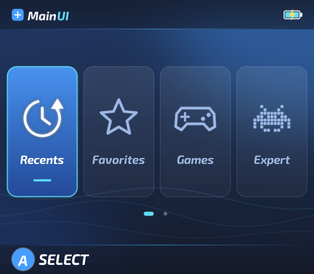 | 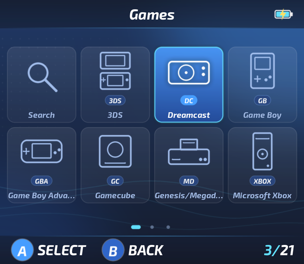 | 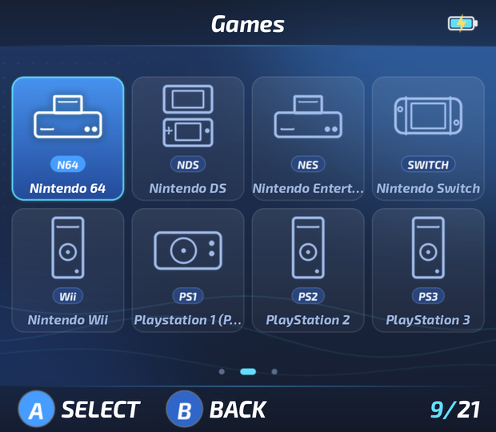 |

| In-game menu (Home in a game) | Game Switcher (hold Home) | Game list (Logiqx DAT names) |
|---|---|---|
| 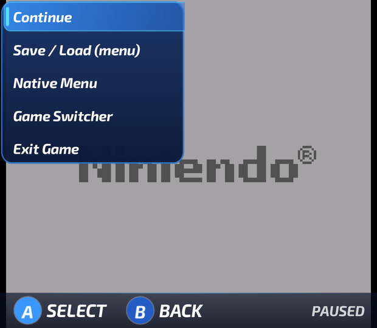 | 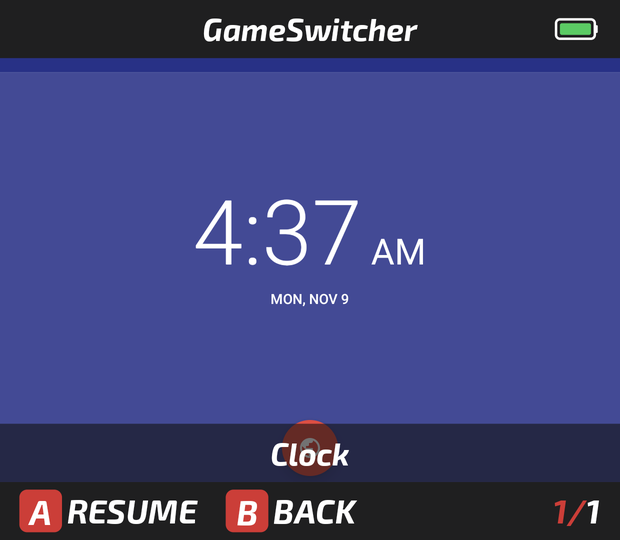 | 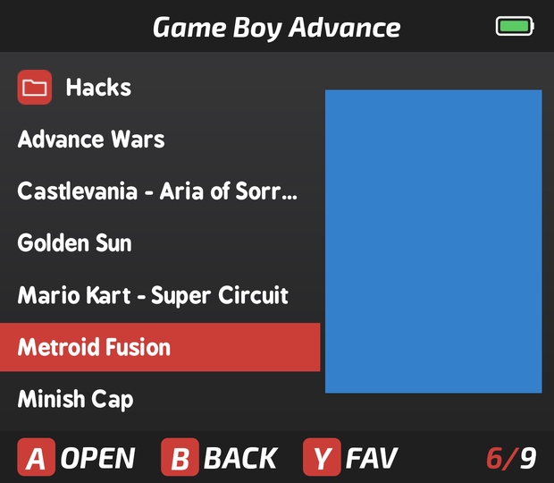 |

| Controls (Home button) | RetroArch cores | About |
|---|---|---|
| 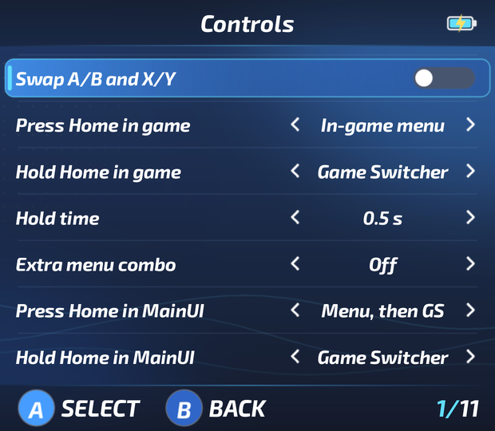 | 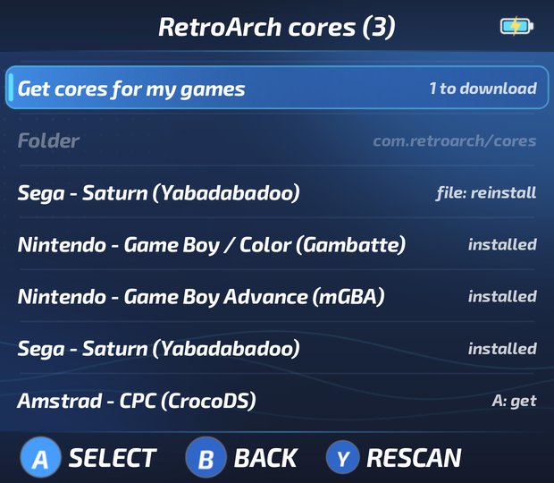 | 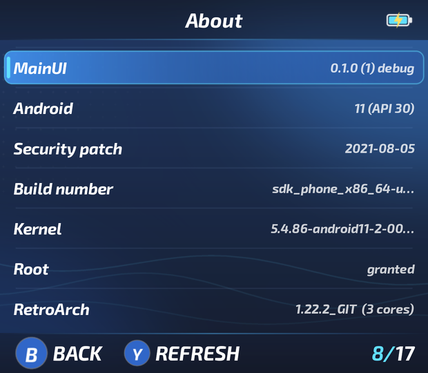 |

| Apps | App Store (F-Droid repos) | Theme downloader (OnionUI/Themes) |
|---|---|---|
| 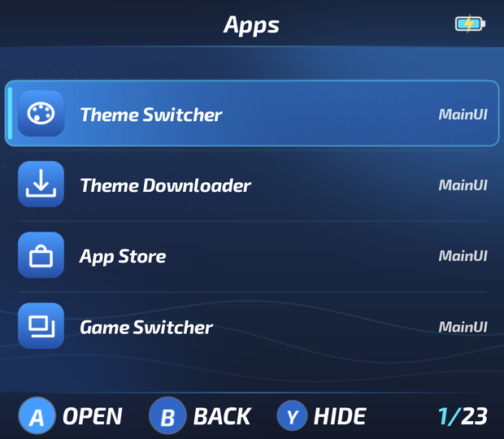 | 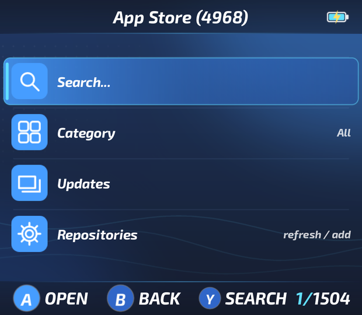 | 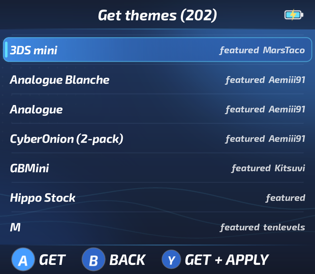 |

| App Store > Emulators | An emulator's page |
|---|---|
| 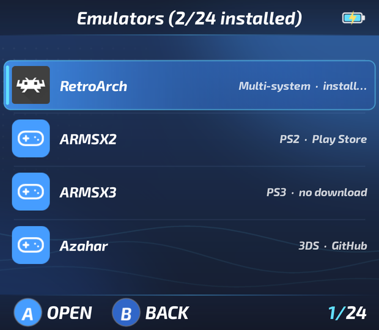 | 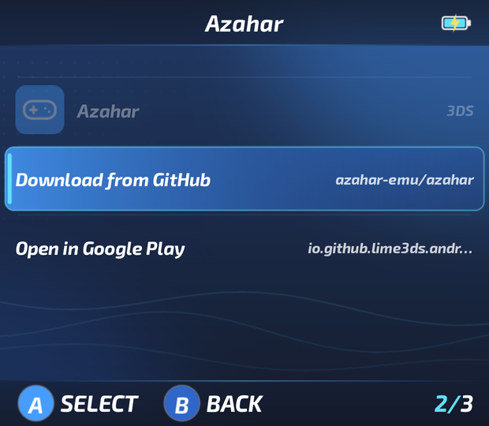 |

Screenshots use the bundled **MainUI** theme and placeholder roms; any OnionOS theme replaces the look.

## Features

| # | Feature | How it works |
|---|---------|--------------|
| 0 | **Default theme** | A blue OnionOS-format theme ("MainUI") ships with the app: gradients, card tiles, and its own picture for **every** system MainUI knows (126 + Android): the console, handheld or computer itself (no logos), including PS2, PS3, Vita, Switch, Xbox, Wii, GameCube and 3DS. No two systems share an icon. OnionOS themes that lack an icon for a system borrow this theme's. "MainUI Classic" keeps the old flat look. Generated by `tools/theme/make_mainui_theme.py` (system pictures in `tools/theme/system_glyphs.py`). |
| 1 | **OnionOS theme support** | Reads Onion `config.json` (title / hint / list / grid / currentpage / total / batteryPercentage / hideLabels / frame), with the same defaults and fallback rules as Onion's `theme_loadFromPath()`. Uses `skin/*.png`, `skin/extra/*`, `icons/*.png`, `icons/sel/*.png`, `icons/app/*.png`, `sound/change.wav`, `sound/bgm.mp3` and `preview.png`. Anything a theme lacks is drawn by MainUI so partial themes still look complete. |
| 2 | **OnionOS layout** | Header and footer bars, 1x4 main menu that slides one tile at a time instead of paging (so no half-empty last page; one dot per tile), 4x2 games grid, 60 px small / 90 px large lists anchored like Onion's, `A SELECT  B BACK` hints, `n/total` status. Optional **row view**: the grid's own cells in one scrolling row, for the games screen and/or as the home screen. |
| 3 | **dArkOS folder structure** | `roms/<system>/` with dArkOS folder names for 120+ systems (generated from the dArkOS wiki), plus `ps2`, `ps3`, `psvita`, `switch`, `xbox`, `wii`. **Create dArkOS folders** asks for Internal storage or SD card and only adds missing folders: existing rom folders are used as they are. Rom folders anywhere can be added with a folder browser. Artwork from `gamelist.xml`, `images/`, `media/images/`, `Imgs/` (Onion) and more, on either volume. Full `gamelist.xml` parser and writer, and **Logiqx DAT** (`.dat`, Skraper's generic profile) as an alternative or addition (Settings > Library > Game metadata). Folders without playable files (e.g. RetroArch's per-core save folders) are hidden. |
| 4 | **ScreenScraper scraper** | Multi-threaded: uses the `maxthreads` your ScreenScraper account allows (more threads for donors), honours per-minute limits, CRC/MD5/SHA1 matching, region and language priority, 8 media types. Saves images to the **SD card or internal storage** and updates `gamelist.xml`. Runs as a foreground service. |
| 5 | **Emulator / core detection** | Detects RetroArch and its cores wherever they are: the `libretro_directory` from `retroarch.cfg`, `/data/data/<pkg>/cores`, the app's native libraries and split APKs (Play Store builds), re-checked when you come back to MainUI and before every launch. 25+ standalone emulators (ES-DE's launch rules). Per-system and per-game core selection like Onion (`SELECT` on a game > Core). **Missing cores are downloaded** from the libretro buildbot (same files as RetroArch's Online Updater) when you launch a game or pick one; *Get cores for my games* fetches one for every system that has roms but no core. Custom builds go in `MainUI/cores`. |
| 6 | **Rom search** | Search tile in the games grid (or `Y` on most screens): on-screen keyboard (A types, B deletes, START or OK confirms, SELECT or CANCEL leaves without changes), results across every system and Android games. |
| 7 | **Game Switcher** | Onion's GameSwitcher: full screen screenshots of recent games, `LEFT/RIGHT` browse, `A` resume, `X` remove, `Y` view mode, `SELECT` play time, `UP/DOWN` brightness, `gs-top-bar` / `gs-bottom-bar` / `gs-legend` / `lum0-10` theme art. |
| 8 | **Apps menu** | Every launchable Android app with its icon. `Y` hides an app; hidden apps live in their own **Hidden apps** menu (with *Edit hidden apps...* to toggle any app). `SELECT` for app info, uninstall, move to Android games. |
| 9 | **Theme Switcher + downloader** | Full screen previews, applies instantly, installs `.zip` themes dropped into a `Themes` folder. **Theme Downloader** browses the [OnionUI theme repository](https://github.com/OnionUI/Themes) on GitHub (200+ themes, the repository's featured ones first) with previews: `A` get, `Y` get and apply, `START` refresh. |
| 10 | **Android system** | An "Android" system for native games. Add games by hand or let MainUI sort apps that declare themselves games into it automatically on install. |
| 11 | **Process manager** | Lists apps MainUI launched first (current game marked), with memory and CPU. Switch to, force stop one, or stop everything MainUI launched (root). |
| 12 | **In-game menu** | Press **Home** in a game: the game is paused, then a Miyoo style menu appears over it (one press, flush with the top of the screen) with **Continue, Save / Load, Native Menu, Game Switcher, Exit Game**. Hold Home for the Game Switcher; both are configurable, also for Home inside MainUI. See [Emulators](#emulators) for what Save/Load can do per emulator. |
| 13 | **App Store** | Controller driven client for F-Droid compatible repositories (F-Droid and IzzyOnDroid by default, add your own with `?fingerprint=`): signed index verification, search, categories, updates, install (silent with root, otherwise Android's installer). Downloads (indexes, APKs, cores, themes) use up to 6 parallel connections when the server supports ranges, an unchanged index is not downloaded again, repositories refresh at the same time, and the mirrors listed in a repository's signed index are used if the repository itself fails. Its **Emulators** section lists every emulator MainUI can launch, what it runs, and installs it from the best source: an F-Droid repository (RetroArch, PPSSPP, Dolphin...), the project's latest GitHub release (Azahar, Flycast, melonDS, MAME4droid, hakuX, Vita3K), or retroarch.com; otherwise it opens the Google Play page or website. Launching a game whose emulator is missing offers its page. |
| 14 | **About** | Device, chipset, CPU, display, RAM and storage use, battery, MainUI / Android / kernel versions, root and RetroArch status. *Build number* opens Developer options (turning them on first with root). |
| 15 | **Touch** | Tap to select / open, tap the button hints (`B BACK` etc.), drag to scroll, swipe to change page. |

## Install

1. Build (see below) or download the APK and install it.
2. Open MainUI. The setup screen walks you through:
   - **All files access** (required, to read roms and themes).
   - **Set MainUI as home app** so the Home button returns to it.
   - **In-game menu overlay**: Android Settings > Accessibility > *MainUI in-game menu*.
   - **Root**: grant MainUI superuser in Magisk (core detection, process manager, key injection, force stop).
3. In **Settings > Emulators & cores**, run **Configure RetroArch for MainUI** once. It makes RetroArch
   pause itself while MainUI's menu is open, flush in-game saves every 10 s, auto save a state on exit,
   and turns on the network command port (used by RetroArch builds that include it; the official
   Android builds don't, see below).
4. **Settings > Emulators & cores > RetroArch cores > Get cores for my games** downloads a core for
   every system you have roms for (root).

## Storage layout

```
<SD card or internal storage>/
├── roms/                    dArkOS layout (also roms2/)
│   ├── gba/
│   │   ├── Game.gba
│   │   ├── gamelist.xml     names, descriptions, image paths (ES / Skraper / MainUI scraper)
│   │   └── images/Game.png  artwork (also media/images, Imgs, downloaded_images, boxart)
│   ├── psx/ snes/ nds/ ...
│   └── bios/
├── Themes/                  OnionOS themes (folders or .zip)
└── MainUI/
    ├── config/              recents, favorites, Android games, hidden apps, core choices, play time
    ├── Screenshots/         Game Switcher screenshots
    ├── States/              save slot thumbnails
    ├── Fonts/               extra fonts themes may reference
    ├── theme_overrides/     like Onion's Saves/CurrentProfile/theme (config.json + skin/ overrides)
    ├── cores/               custom RetroArch cores to install (<name>_libretro_android.so or .zip)
    └── emulators.json       optional: your own emulator launch recipes
```

Settings > Library & storage > **Create dArkOS folders** creates every rom folder for you on the
volume you pick, and never touches folders that already exist. **Rom folders** adds other folders
with a folder browser (no typing paths).
Folder names come from the [dArkOS emulator list](https://github.com/christianhaitian/dArkOS/wiki/dArkOS-Emulators-and-Ports-information);
`tools/gen_systems.py` regenerates `app/src/main/assets/systems.json` from that wiki page.
Android-only systems were added with the same naming: `ps2`, `wii`, `switch`.

When a game exists on both the SD card and internal storage the lists merge them.
Artwork is looked up at the same relative path on every volume, so images scraped to
internal storage work for roms on the SD card and the other way round.

## Themes

MainUI ships with its own theme, **MainUI** (blue, with art for every system). It is a normal OnionOS
theme: `tools/theme/make_mainui_theme.py` regenerates it (Pillow), and it can be copied to a Miyoo Mini.

Get more themes in **Apps > Theme Downloader** (the [OnionUI theme repository](https://github.com/OnionUI/Themes)),
or copy an OnionOS theme folder (or its `.zip`) into `Themes/`, then pick it in **Apps > Theme Switcher**.
Systems a theme has no icon for (most OnionOS themes stop at the Miyoo's systems) use the MainUI icons.

Differences from a Miyoo Mini, due to the screen:

- The Retroid Pocket Mini V2 screen (1240x1080) is narrower than 4:3. MainUI keeps the theme's
  640 px width and gains about 77 px of height (a 640x557 canvas). Header and footer stay at the
  top and bottom, content is centred, and lists show one extra row.
- Backgrounds are cropped to fill the screen by default (Settings > User interface > Background fit:
  Crop / Stretch / Fit).
- Fonts that Onion ships (`/mnt/SDCARD/miyoo/app/...`) are matched by file name. BPreplay, Exo 2 and
  Adobe Blank are bundled. Helvetica and Microsoft YaHei are not, because of their licences, so the
  system font is used instead. You can drop font files into `MainUI/Fonts/`.
- Theme authors can add an optional `"mainui": { "accent": "#RRGGBB", "panel": "#AARRGGBB", "background": "#RRGGBB" }`
  block to colour the elements MainUI draws itself.

## Controls

| Where | Button | Action |
|-------|--------|--------|
| Everywhere | D-pad / left stick | Move (held = repeat) |
| | A / B | Select / Back (swap in Settings > Controls) |
| | L1 / R1 | Page up / down |
| | L2 / R2 | Jump to previous / next letter |
| | Home | Main menu, then Game Switcher; hold: Game Switcher (configurable) |
| Main menu / grid | SELECT | Game Switcher (grid: system options) |
| | Y | Search |
| | START (grid) | Rescan roms |
| Game list | Y | Toggle favorite |
| | SELECT | Game options: favorite, core for this game, system core, scrape, info |
| Game Switcher | A / B / X / Y | Resume / back / remove / view mode |
| | SELECT / UP / DOWN | Play time / brightness |
| In game | Home | In-game menu (hold: Game Switcher) |
| Touch | tap / drag / swipe / long press | Select, tap a hint to use it / scroll / next page / SELECT |

## Emulators

RetroArch cores come from the dArkOS list (default core first), followed by any other
installed core whose `.info` file lists a matching extension.

Standalone launch recipes follow [ES-DE](https://es-de.org)'s maintained Android rules
(`es_find_rules.xml` / `es_systems.xml`), which are kept up to date as emulators change their
package or activity names. The in-game menu's Save/Load support depends on what each emulator
exposes:

| Emulator | Systems (folder) | Save / Load from MainUI's in-game menu |
|---|---|---|
| RetroArch (all cores) | everything | Official Android builds: through RetroArch's own quick menu (*Save / Load (menu)*). Builds with network commands: **slots 0-9** while paused |
| ARMSX2 | PS2 (`ps2`) | Hotkeys F1 / F3 (PCSX2's defaults) |
| NetherSX2 / AetherSX2 | PS2 (`ps2`) | Hotkeys F1 / F3 |
| ARMSX3 | PS3 (`ps3`) | No save states |
| Vita3K | PS Vita (`psvita`, `.psvita` files holding the title ID) | No save states |
| hakuX | Xbox (`xbox`) | Through hakuX's own menu |
| PPSSPP | PSP (`psp`) | Hotkeys F2 / F4 (PPSSPP's keyboard defaults) |
| DuckStation | PS1 (`psx`) | Hotkeys F1 / F2 |
| DraStic, melonDS | DS (`nds`) | Hotkeys F1 / F2 |
| Dolphin | GameCube / Wii (`gc`, `wii`) | Hotkeys F1 / F2 |
| Azahar, Lime3DS, Citra | 3DS (`3ds`) | Hotkeys F1 / F2 |
| Flycast | Dreamcast, Naomi, Atomiswave | Hotkeys F1 / F2 |
| M64Plus FZ | N64 (`n64`) | Hotkeys F1 / F2 |
| Dolphin MMJR, Citra MMJ, Redream, Yaba Sanshiro 2, MAME4droid | | Through the emulator's own menu |
| Eden, Kenji-NX | Switch (`switch`) | No save states |

**No Android emulator offers a remote save/load command.** RetroArch has one (network commands),
but the official Android builds are compiled without it (checked in 1.22.2), and injected keyboard
hotkeys did not reach it in testing. MainUI probes for it and otherwise opens RetroArch's quick menu,
where Save State / Load State are. For the
"hotkeys" emulators MainUI closes the menu, unpauses the game and injects the key with root. The key
must be bound in that emulator. MainUI helps with that: open the emulator's hotkey settings, start
binding "Save state", press Home and pick **Bind hotkeys... > Send save key**. MainUI sends the key to
the waiting emulator, so you can bind it with only the handheld's buttons. Without root, hotkey
emulators fall back to "Save / Load (in emulator)", which opens the emulator's own menu.

Recipes live in `app/src/main/assets/emulators.json`. To fix or add one without rebuilding,
copy that file to `MainUI/emulators.json` and edit it (Settings > Emulators & cores, `Y` rescans).
The file documents every field: launch components, intent action / category / data / extras
(`array:` extras for Vita3K), and the in-game `states` / `save` / `load` / `menu` behaviour.
Emulators launched with `%ROMSAF%` (most of them) need to have been given access to your rom
folder once in their own settings, exactly as with ES-DE.

### In-game menu: how it works

1. An accessibility service watches which app is in front. Only while a game MainUI launched is
   in front does it consume the Home key. Everywhere else Home behaves normally.
2. **The game is paused first**: by freezing its process with `SIGSTOP` (root; RetroArch builds with
   network commands get `PAUSE_TOGGLE` instead). Then the paused frame is captured and the menu is
   drawn over it. Android sends the game a "focus lost" event when the menu appears; a frozen app
   can't acknowledge it and would be reported as *not responding* after 5 s, so MainUI lets the
   game's main thread run just long enough to handle it (until it is back in its event loop, usually
   a few milliseconds) and freezes it again. RetroArch is also set to pause itself on focus loss.
   Freezing goes through one persistent root shell, so it takes milliseconds.
3. Every way out of the menu (Continue, Native Menu, Save, Load, Game Switcher, Home, the overlay
   service stopping) resumes the game. The frozen package is also remembered on disk and thawed when
   MainUI or the service starts, so a crash can't leave a game frozen.
4. *Native Menu* opens the emulator's own menu (Back, or `MENU_TOGGLE` where RetroArch has commands).
   *Exit Game* force stops the emulator with root (RetroArch flushes SRAM saves every 10 s once
   configured), after an auto save via its hotkey if it has one.

**Home button behaviour is configurable** (Settings > Controls): *Press Home in game* and *Hold Home
in game* can each be the in-game menu, the Game Switcher, "Go to MainUI" or nothing; *Hold time*
sets how long counts as a hold (0.3-1.5 s). Defaults: press = in-game menu, hold = Game Switcher.
Without the accessibility service, MainUI only receives Android's Home intent, so a hold can't be
detected and the *press* action is used.

Optional extra trigger: Select+Start or L3+R3 (Settings > Controls > Extra menu combo), read through
root `getevent`. It adds no latency, but the game also receives the buttons.

Accessibility key filtering sends every key press through the service before it reaches the game.
The handler returns straight away for anything but Home; if you ever notice input lag, set both
Home actions to "Go to MainUI" (the service then stops consuming keys) and use the combo trigger.

## Getting emulators

Apps > App Store > **Emulators** (also Settings > Emulators & cores > *Get emulators*, the core picker,
and the prompt when a game's emulator is missing). For each emulator, in order:

1. **F-Droid compatible repository**: if any enabled repository has the package (found by package
   name in the signed index; F-Droid itself has RetroArch, PPSSPP, Dolphin, Mupen64Plus AE, Lemuroid).
2. **GitHub**: the APK of the project's latest release (`api.github.com`, no account needed; 60
   requests per hour). The APK matching the device's CPU is picked; store and debug flavours are skipped,
   and GitHub's SHA-256 digest is checked when the release has one.
3. **retroarch.com** for RetroArch (the 64-bit build on arm64 devices).
4. Otherwise **Google Play** or the project's **website** is opened.

Sources live in `emulators.json` (`"get"`), so they can be fixed in `MainUI/emulators.json` without
an update. An app installed from one source can't be updated from another (Android checks the
signature); MainUI says so instead of offering it.

## RetroArch cores

Settings > Emulators & cores > **RetroArch cores** lists installed cores and every core MainUI
recommends. `A` on a missing core downloads it from `buildbot.libretro.com/nightly/android/latest/<abi>/`
and installs it into RetroArch's core folder with RetroArch's owner and SELinux label (root).
Launching a game whose core is missing offers the same download instead of failing.
Android 11+ hides every other app's `/data/data` folder from an app, and Magisk's `su` starts in the
app's view by default, so MainUI runs its root commands in the system-wide view (`nsenter -t 1 -m`,
or `su --mount-master` if `nsenter` is missing). Without that, RetroArch's core folder looks empty.
Play Store RetroArch keeps each downloaded core in a feature module (`core_mgba`, holding `libmgba.so`)
and links it into its cores folder when it starts; MainUI lists that folder with root and, without
root, recognizes the installed modules.
**Download all cores** fetches every core the buildbot has that isn't installed yet (about 250 for
arm64, roughly 0.9 GB to download): it shows the count and size first, warns if storage looks too
small, installs three at a time, and B stops it after the cores in progress.

Cores that aren't on the buildbot can be installed from **`MainUI/cores`**: drop
`<name>_libretro_android.so` (or a `.zip` of it, optionally with `<name>_libretro.info`) there and it
appears in the list. Example: **Yabadabadoo** (a Saturn core tuned for the Miyoo Mini) is listed for
Saturn; its releases are Miyoo (Linux) builds that Android can't load, but its source builds for
Android with the NDK (`yabause/src/libretro`, `ndk-build`).

## Scraper

ScreenScraper requires a **developer ID** for every application that uses its API. Developer
IDs are free; ask the ScreenScraper team for one through the forum on [screenscraper.fr](https://www.screenscraper.fr).
Enter it under Apps > Scraper > Developer ID, or build it into the APK:

```properties
# local.properties (not committed)
screenscraper.devid=yourDevId
screenscraper.devpassword=yourDevPassword
```

Then add your normal ScreenScraper username and password. The scraper reads your account's
`maxthreads` and runs that many workers (anonymous: 1). Images are written to
`roms/<system>/images/<rom>.png` on the volume chosen under **Save images to**, and `gamelist.xml`
is updated (a `gamelist.xml.bak` is kept the first time). Scraping keeps running in the background
with a notification. `SELECT` on a system or game scrapes just that.

## Building

Requirements: JDK 17+, Android SDK with platform 35.

```bash
./gradlew assembleRelease
```

```bash
./gradlew testDebugUnitTest
```

Debug builds read a few system properties so root features and downloads can be tested on an
emulator without internet or a working `su`: `debug.mainui.rootport` (a root shell server on
127.0.0.1:<port>), `debug.mainui.themebase` and `debug.mainui.corebase` (local mirrors of the theme
repository and the libretro buildbot). Release builds ignore them.

The release APK is signed with the debug key so it can be sideloaded directly:
`app/build/outputs/apk/release/app-release.apk`.

## Known limitations

- **Standalone emulators are only partly tested.** RetroArch was tested on the emulator; PPSSPP
  launches. The other recipes come from ES-DE's maintained rules, and the save/load hotkeys listed
  above are those emulators' defaults, not verified one by one. Use `MainUI/emulators.json` to fix one.
- The RetroArch UDP command path (pause, slots, quit) is only used by builds that answer on the port;
  the official Android builds don't.
- Retroid's Home button must arrive as a normal `KEYCODE_HOME` key for the overlay to catch it.
  Keys injected with `adb shell input` skip accessibility filters, so test with the real button.
- ScreenScraper system IDs in `systems.json` were mapped by hand; a few rare systems may be wrong
  or missing (`null` = not scraped).
- RetroArch core detection and downloads need root for the default core folder (RetroArch's private
  storage). Without root, cores packed in RetroArch's APKs are still found; others are marked `?`.
- Play Store RetroArch builds deliver cores as split APKs; MainUI finds them there, but launching
  them that way is untested. The website / F-Droid builds are recommended (as with ES-DE).
- `SAVE_STATE_SLOT` / `LOAD_STATE_SLOT` need RetroArch 1.17 or newer; older versions fall back to
  stepping slots.
- Ports (PortMaster) are Linux-only and are not shown.
- No Wi-Fi / Bluetooth / volume settings yet. Settings > Android settings opens the stock ones. Replacing
  more of the stock UI is the next step.

## Licence

GPL-3.0 (see `LICENSE`). Bundled fonts are under the SIL Open Font License (`app/src/main/assets/fonts/OFL-*.txt`).
No Miyoo or OnionOS theme art is bundled; the default look is drawn in code.
